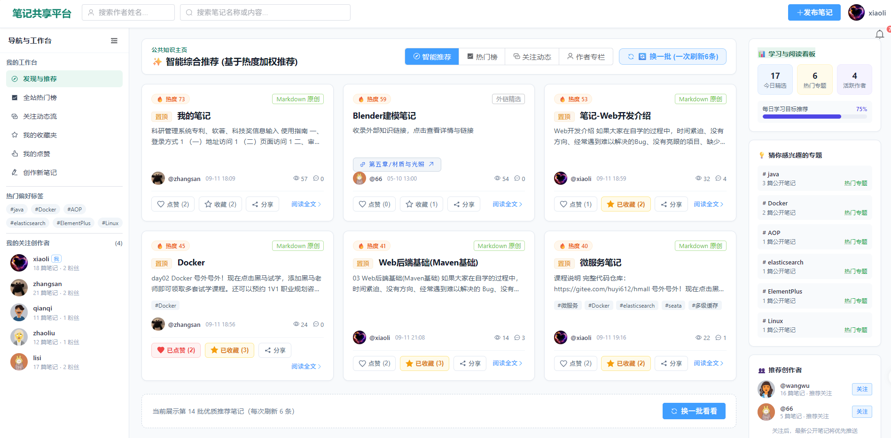
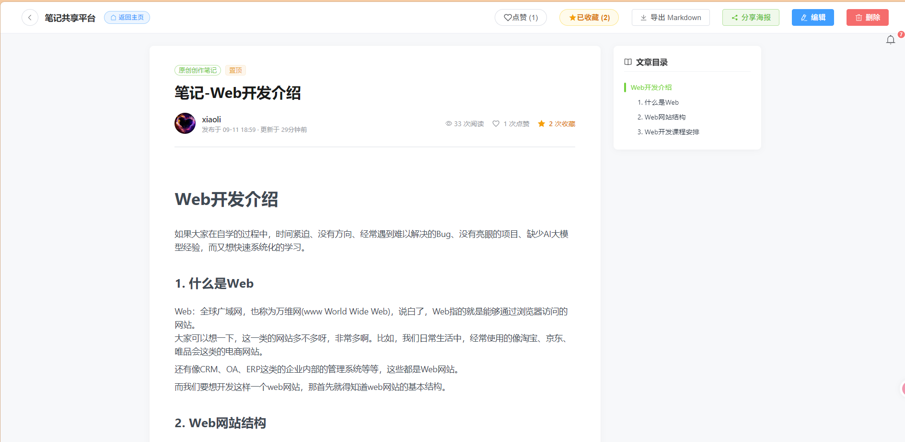

# 学生笔记共享平台

一个面向学生的笔记共享与知识管理平台，支持 Markdown 创作、外链收藏、公开/私密笔记、点赞收藏、评论互动、作者关注、消息通知、回收站和管理端运营管理。

项目采用前后端分离架构，包含：

- **用户端**：笔记浏览、搜索、创作、互动与个人空间。
- **管理端**：平台数据、用户、笔记、评论、消息和系统内容管理。
- **后端服务**：统一认证、业务接口、数据访问、缓存和文件存储。

## 产品截图

### 用户端首页

首页提供智能综合推荐、热门榜、关注动态、作者专栏、热门标签、推荐作者和学习数据概览。



### 笔记详情页

详情页支持 Markdown 内容阅读、文章目录、点赞、收藏、评论、Markdown 导出和分享海报。



## 主要功能

### 用户端

- **账号与认证**
  - 邮箱验证码注册
  - 用户名密码登录
  - 忘记密码：通过注册邮箱验证码重置密码
  - 重置密码后自动使旧登录令牌失效
  - 登录失败次数限制与账号锁定
- **笔记管理**
  - Markdown 原创笔记创作与编辑
  - 外链笔记收藏与访问
  - 笔记公开/私密设置
  - 笔记标签、摘要、封面和目录
  - 笔记回收站、软删除、恢复和彻底删除
  - Markdown 文件导出
  - 分享海报与可扫描二维码
- **发现与搜索**
  - 智能综合推荐
  - 热门笔记榜
  - 关注动态流
  - 推荐作者
  - 作者和笔记双栏搜索
  - Markdown 正文搜索
  - 热门标签与专题推荐
- **互动功能**
  - 点赞与取消点赞
  - 我的点赞列表（后端分页查询）
  - 收藏与取消收藏
  - 评论、回复和评论关系展示
  - 关注/取消关注作者
  - 粉丝列表与回关
  - 站内通知中心
  - 用户可移除自己的通知消息
- **个人中心**
  - 个人资料与个性签名
  - 头像上传
  - 修改密码
  - 粉丝管理
  - 笔记回收站

### 管理端

- 管理员登录、权限校验和密码管理
- 仪表盘概览与平台趋势统计
- 用户列表、详情、状态、解锁和密码重置
- 笔记列表、详情、置顶、软删除、恢复和批量操作
- 外链管理
- 敏感词管理与批量导入
- **评论管理**
  - 评论分页查询
  - 按关键词、删除状态和时间范围筛选
  - 评论软删除与恢复
  - 查看评论作者、所属笔记和回复关系
- **用户消息管理**
  - 汇总查询所有用户通知
  - 按接收用户、通知类型、已读状态、删除状态、关键词和时间筛选
  - 通知软删除、隐藏与恢复
- 操作日志记录与查询
- 管理员账号管理

## 访问地址

| 服务 | 地址 | 说明 |
| --- | --- | --- |
| 用户端开发服务 | <http://localhost:5173> | Vite + Vue 3 |
| 用户端生产服务 | <http://localhost:80> | Nginx |
| 管理端开发服务 | <http://localhost:5174> | Vite + Vue 3 + ECharts |
| 管理端生产服务 | <http://localhost:81> | Nginx |
| 后端 API | <http://localhost:8080/api> | Spring Boot |
| Swagger 文档 | <http://localhost:8080/api/swagger-ui.html> | 在线接口文档 |
| OpenAPI JSON | <http://localhost:8080/api/openapi.json> | 可导入 Apifox |

## 默认账号

| 角色 | 用户名 | 密码 | 说明 |
| --- | --- | --- | --- |
| 超级管理员 | `admin` | `admin123` | 首次登录后请立即修改密码 |
| 普通用户 | 自行注册 | 自定义 | 注册需要邮箱验证码 |

## 技术栈

### 后端

- Java 17
- Spring Boot 3.2
- Spring MVC
- Spring Validation
- Spring Security
- JWT
- MyBatis-Plus 3.5
- MySQL 8.0
- Redis
- Spring Boot Mail
- Springdoc OpenAPI
- 阿里云 OSS
- Hutool
- ZXing Core（二维码生成）

### 用户端前端

- Vue 3.4
- TypeScript
- Element Plus
- Pinia
- Vue Router 4
- Axios
- Vite 5
- md-editor-v3

### 管理端前端

- Vue 3.4
- TypeScript
- Element Plus
- ECharts
- Pinia
- Vue Router 4
- Axios
- Vite 5

## 项目结构

```text
project/
├── note-backend/                         # Spring Boot 后端
│   ├── src/main/java/com/note/
│   │   ├── controller/
│   │   │   ├── user/                    # 用户端接口
│   │   │   └── admin/                   # 管理端接口
│   │   ├── service/                     # 业务服务
│   │   ├── mapper/                      # MyBatis Mapper
│   │   ├── entity/                      # 数据库实体
│   │   ├── dto/                         # 请求对象
│   │   ├── vo/                          # 响应对象
│   │   ├── config/                      # Spring 与数据库配置
│   │   ├── interceptor/                 # 用户端/管理端鉴权拦截器
│   │   ├── exception/                   # 统一异常处理
│   │   ├── enums/                       # 错误码
│   │   └── util/                        # JWT、验证码等工具
│   └── src/main/resources/
│       ├── mapper/                      # MyBatis XML
│       ├── application.yml              # 默认配置
│       ├── init.sql                     # 用户端数据库初始化
│       ├── init_admin.sql               # 管理端数据库初始化
│       └── init_with_test_data.sql      # 测试数据初始化
│
├── note-frontend/
│   ├── user/                            # 用户端前端
│   └── admin/                           # 管理端前端
│
├── project/deploy/                       # Nginx 与集群部署配置
├── 软著/                                 # 软件著作权材料与产品截图
├── prd.md                                # 用户端产品需求
├── admin-prd.md                          # 管理端产品需求
└── README.md
```

## 快速开始

### 环境要求

- JDK 17+
- Maven 3.8+
- Node.js 18+
- npm 9+
- MySQL 8.0+
- Redis 6+

### 1. 初始化数据库

```bash
# 创建数据库
mysql -u root -p -e "CREATE DATABASE IF NOT EXISTS note_sharing DEFAULT CHARSET utf8mb4 COLLATE utf8mb4_unicode_ci;"

# 初始化用户端表
mysql -u root -p note_sharing < project/note-backend/src/main/resources/init.sql

# 初始化管理端表
mysql -u root -p note_sharing < project/note-backend/src/main/resources/init_admin.sql
```

如需导入演示数据，可根据实际环境执行：

```bash
mysql -u root -p note_sharing < project/note-backend/src/main/resources/init_with_test_data.sql
```

### 2. 配置后端

编辑 `project/note-backend/src/main/resources/application.yml`，配置数据库、Redis、JWT、邮件和 OSS 信息。示例：

```yaml
spring:
  datasource:
    url: jdbc:mysql://localhost:3306/note_sharing?useUnicode=true&characterEncoding=utf8&useSSL=false&serverTimezone=Asia/Shanghai&allowPublicKeyRetrieval=true
    username: root
    password: your_mysql_password
  data:
    redis:
      host: localhost
      port: 6379
      password: your_redis_password
  mail:
    host: smtp.example.com
    port: 587
    username: your_mail@example.com
    password: your_smtp_password
```

忘记密码和用户注册都依赖邮件服务；请确认 SMTP 账号、授权码和网络连接可用。

### 3. 启动后端

#### 方式一：Docker Compose

```bash
cd project/note-backend
docker-compose up -d
```

#### 方式二：Maven

```bash
cd project/note-backend
mvn spring-boot:run
```

后端默认运行在 `http://localhost:8080`，接口上下文路径为 `/api`。

### 4. 启动用户端

```bash
cd project/note-frontend/user
npm install
npm run dev
```

### 5. 启动管理端

```bash
cd project/note-frontend/admin
npm install
npm run dev
```

## API 概览

### 用户端接口

用户端接口前缀为 `/api/user/`，主要模块包括：

| 模块 | 路径 | 说明 |
| --- | --- | --- |
| 认证 | `/user/auth` | 注册、登录、发送验证码、邮箱重置密码、退出登录 |
| 用户 | `/user/users` | 当前用户、用户主页、关注相关信息 |
| 笔记 | `/user/notes` | 笔记 CRUD、推荐、热门、点赞、收藏、回收站 |
| 评论 | `/user/notes/{id}/comments` | 评论与回复 |
| 搜索 | `/user/search` | 作者和公开笔记搜索 |
| 通知 | `/user/notifications` | 通知列表、已读和用户移除 |
| 分享 | `/user/share` | Markdown 导出和分享二维码 |
| 标签 | `/user/tags` | 热门标签与专题 |

忘记密码相关接口：

```text
POST /api/user/auth/send-code
请求：{"email":"user@example.com","scene":"resetPassword"}

POST /api/user/auth/reset-password
请求：{"email":"user@example.com","verificationCode":"123456","newPassword":"newpass123"}
```

### 管理端接口

管理端接口前缀为 `/api/admin/`，主要模块包括：

| 模块 | 路径 | 说明 |
| --- | --- | --- |
| 认证管理 | `/admin/auth` | 管理员登录、个人信息和改密 |
| 仪表盘 | `/admin/dashboard` | 平台概览、趋势和热门数据 |
| 用户管理 | `/admin/users` | 用户查询、状态、解锁和密码重置 |
| 笔记管理 | `/admin/notes` | 笔记查询、置顶、删除、恢复和批量操作 |
| 评论管理 | `/admin/comments` | 评论查询、软删除和恢复 |
| 用户消息 | `/admin/notifications` | 全量通知查询、筛选、移除和恢复 |
| 链接管理 | `/admin/links` | 外链查询、编辑和删除 |
| 敏感词管理 | `/admin/words` | 敏感词 CRUD、导入和状态管理 |
| 数据统计 | `/admin/stats` | 用户、笔记和互动统计 |
| 操作日志 | `/admin/logs` | 管理操作审计记录 |
| 管理员管理 | `/admin/admins` | 超级管理员账号管理 |

## 安全与数据设计

- 用户端和管理端使用独立鉴权拦截器。
- 密码使用 BCrypt 哈希保存，不保存明文密码。
- 邮箱验证码使用 Redis 保存，具备有效期、发送间隔和每日发送次数限制。
- 忘记密码验证码使用独立 `resetPassword` 场景，成功验证后立即失效。
- 重置密码后旧 JWT 令牌失效，避免旧会话继续访问平台。
- 未注册邮箱的忘记密码请求返回通用提示，避免泄露账号是否存在。
- 笔记、评论和通知支持软删除，便于管理端审查与恢复。
- 外部链接只允许 HTTP/HTTPS 协议，阻止危险脚本协议。
- 管理端删除、恢复等操作写入操作日志。

## 常用开发命令

### 后端

```bash
cd project/note-backend

# 编译
mvn -DskipTests compile

# 运行测试
mvn test

# 打包
mvn package -DskipTests
```

### 用户端前端

```bash
cd project/note-frontend/user

# 类型检查
npm run type-check

# 生产构建
npm run build
```

### 管理端前端

```bash
cd project/note-frontend/admin

# 类型检查
npx vue-tsc --noEmit

# 生产构建
npm run build
```

## 生产部署

集群部署配置位于 `project/deploy/`：

| 文件 | 说明 |
| --- | --- |
| `nginx-lb.conf` | 用户端、管理端和后端集群的 Nginx 配置 |
| `start-cluster.bat` | 启动多个后端实例 |
| `stop-cluster.bat` | 停止后端集群 |

基本流程：

```bash
# 构建后端
cd project/note-backend
mvn package -DskipTests

# 启动后端集群
cd ../deploy
start-cluster.bat
```

## 相关文档

| 文档 | 路径 | 说明 |
| --- | --- | --- |
| 用户端 PRD | `prd.md` | 用户端产品需求 |
| 管理端 PRD | `admin-prd.md` | 管理端产品需求 |
| 用户端数据库与接口设计 | `用户端数据库与接口设计计划.md` | 用户端数据表与接口设计 |
| 管理端数据库与接口设计 | `管理端数据库与接口设计计划.md` | 管理端数据表与接口设计 |
| 管理端接口详情 | `管理端接口数据库.md` | 管理端接口示例 |
| OpenAPI 文档 | `combined-api-docs.json` | 用户端与管理端 API 定义 |
| 软件著作权材料 | `软著/` | 说明文档、源码文档和产品截图 |
